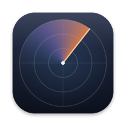
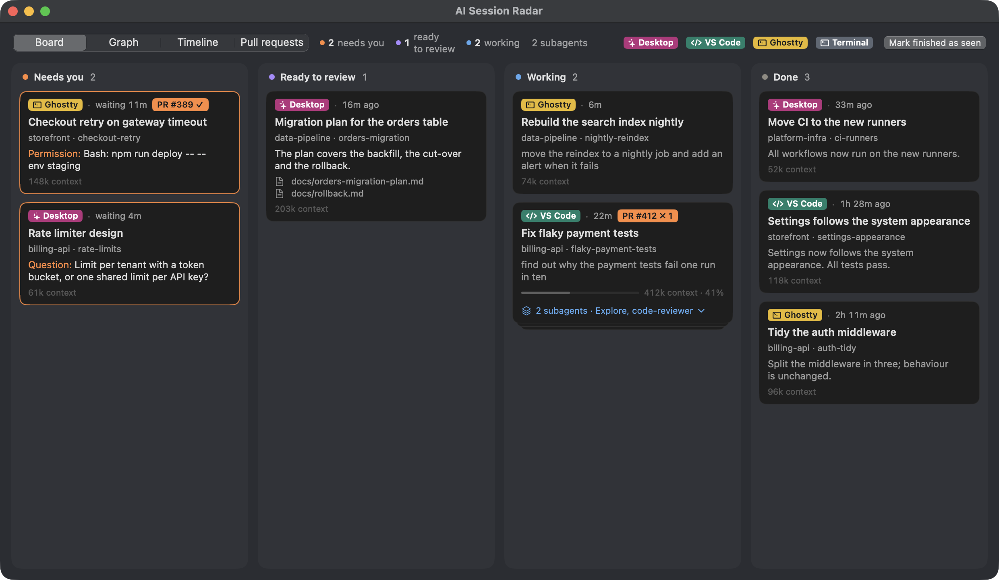
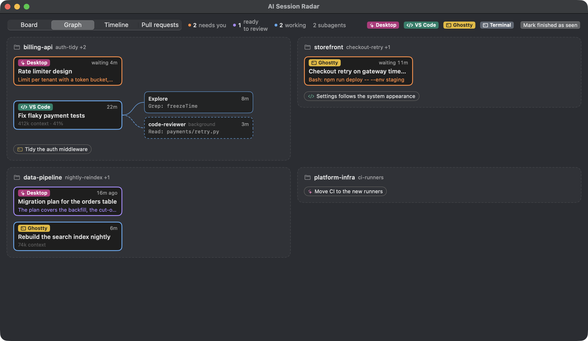
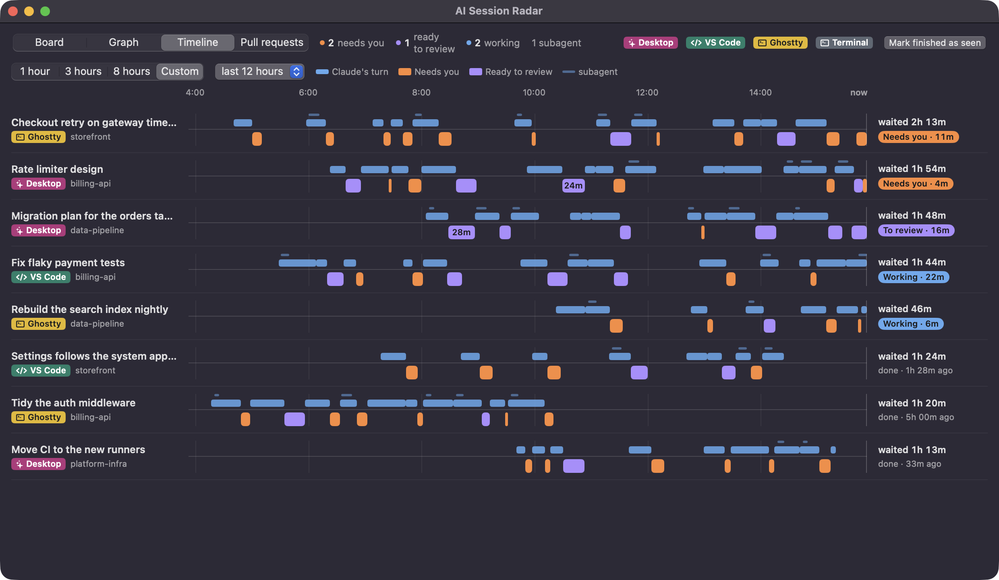
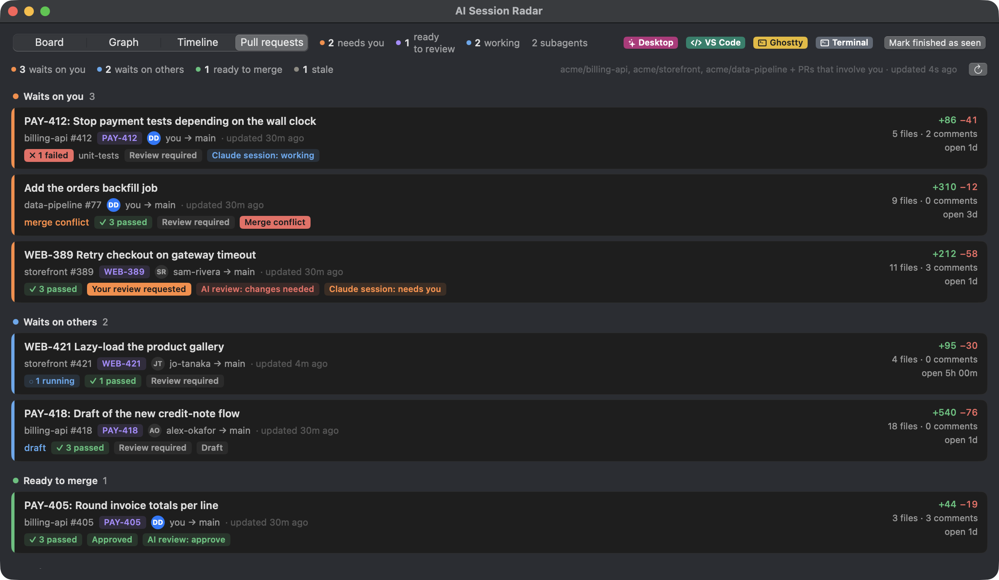

# AI Session Radar

**Where am I waiting, and who is waiting on me?** One view of every Claude Code session on
your Mac, whether it runs in the Claude Desktop app, the VS Code extension or a terminal, sorted
by who has to act next. Your open pull requests sit next to them, with their checks, reviews and
AI review. Menu bar app; the board opens in its own window.

[](https://github.com/rwijnen/ai-session-radar/actions/workflows/ci.yml)
[](LICENSE)
[](#development)
[](#development)
[](#ai-transparency)

> **Not affiliated with Anthropic.** AI Session Radar is an independent tool that reads the
> hooks and session files of [Claude Code](https://claude.com/claude-code). It is not made,
> endorsed or supported by Anthropic.

> **This app was vibecoded.** Effectively all of the code, tests and documentation were
> written by Claude Opus 5.5 in Claude Code. See [AI transparency](#ai-transparency).



<sub>All screenshots show made-up sessions and pull requests.</sub>

---

## Install

1. Download `AI-Session-Radar.zip` from the [latest release](https://github.com/rwijnen/ai-session-radar/releases/latest),
   unzip it and move **AI Session Radar** to Applications.
2. The release is signed but not notarized, so the first launch of a browser download meets
   Gatekeeper. Either right-click the app › **Open** (on macOS 15 and later: try to open it once,
   then System Settings › Privacy & Security › **Open Anyway**), or run once:
   ```bash
   xattr -dr com.apple.quarantine "/Applications/AI Session Radar.app"
   ```
3. Open it. A welcome window checks what it needs and installs the Claude Code hooks when you
   press **Install hooks** (see [First run](#first-run)).

From then on it updates itself (see [Updates](#updates)).

To build it yourself instead (no Xcode needed, the Command Line Tools are enough):

```bash
git clone https://github.com/rwijnen/ai-session-radar.git
cd ai-session-radar && ./build.sh --install
```

A self-built copy is signed ad-hoc unless you have an Apple signing identity, and an ad-hoc copy
never updates itself and may not get notification permission. Use the release for that.

**Requirements:** macOS 14 or later; Python 3.9 or later, which comes with Apple's Command Line
Tools (`xcode-select --install`; most developers have them already, since `git` needs them) or
Homebrew; Claude Code in any of its apps. The [GitHub CLI](https://cli.github.com) (`gh`), signed
in, only for pull requests.

## First run

The welcome window (later: **Settings…** in the menu, ⌘,) checks three things:

- **Python 3.** The hooks and the data layer are a small Python package with no dependencies.
  The app looks for a working Python 3.9+ in `/usr/bin` (only when the Command Line Tools are
  installed, since without them that file is a stub that opens an install dialog), then Homebrew.
- **Claude Code hooks.** **Install hooks** adds the radar's hooks to `~/.claude/settings.json`,
  which every Claude Code surface reads. Your own hooks and settings stay exactly as they are,
  and the file is backed up first (`settings.json.bak.<time>`). **Remove** takes them out again.
  Sessions pick the hooks up when they start; sessions already running show as *not tracked
  yet* until they restart.
- **GitHub CLI.** Optional. Without it, switch pull requests off.

The hooks run a copy of the Python package that the app keeps in `~/.claude/radar/lib` and
refreshes after every update, so moving or updating the app never leaves Claude Code calling a
missing file. If the hooks ever point somewhere else (another copy of the app, or an older
build), Settings says so and offers **Repair**.

## What you see

**Menu bar.** Coloured counts: ● orange *needs you*, ● purple *ready to review*, ● blue *working*,
and a pull-request symbol with the PRs that wait on you. The menu lists the sessions and those
PRs; clicking one jumps to it.

| Column | A session lands here when |
|---|---|
| **Needs you** | it asks permission for a tool, asks you a question, waits for plan approval, or the turn failed |
| **Ready to review** | the turn finished and wrote a document (`.md`, `.html`, `.pdf`, `.docx`, `.xlsx`, `.pptx`, `.csv`, `.svg`) or published an Artifact |
| **Working** | Claude is busy |
| **Done** | the turn finished with nothing to review, or you marked it seen |

**Board** (⌘B in the menu, or open the app again from Spotlight). Four views, ⌘1 to ⌘4:

- **Board**: four quiet columns. A session's subagents fold into a stack under its card. Open
  and Seen appear when you hover a card; a session on a branch with an open PR gets a *PR #n* badge.
- **Graph**: sessions grouped by project folder, each subagent linked to the session that started it.
- **Timeline**: the last 1, 3 or 8 hours as turn-taking. Claude's turns sit above each lane's
  centre line, yours (Needs you, Ready to review) below it with their minutes, and on the right
  how long the session waited for you.
- **Pull requests**: see below.





Double-click any card, node or lane to jump to its session. Session names are the ones the apps
show: the Desktop title, or for VS Code and terminal sessions the tab's title (Claude Code's own
title, or the name you gave it with `/rename`).

**Apps.** Each session is labelled with its app in its own colour: **Desktop** magenta,
**VS Code** green, **Ghostty** yellow, other terminals slate.

**Subagents.** Every running subagent gets a small card under its session in Working, with its
type, its task, its current tool call and how long it has run. Activity inside a subagent never
moves its session, except a permission prompt, which waits for you.

**Jumping back.** Desktop sessions open exactly, through the app's `claude://` link. For VS Code
the app focuses the window with the folder the session started in, also after the session moved
into a git worktree; for terminals it brings the terminal to the
front. Picking the right tab there is up to you: neither app allows that from outside.

### Pull requests

Every open PR in the repositories you watch (Settings › Pull requests), plus every open PR
anywhere that involves you (author, reviewer, assignee, mention), grouped by who has to act:



| Group | A PR lands here when |
|---|---|
| **Waits on you** | your review is requested, or your own PR has failed checks, changes requested or a merge conflict |
| **Waits on others** | checks are running, a review is pending, or it is a draft |
| **Ready to merge** | it is approved, its checks passed and it has no conflict |
| **Stale** | nothing happened for 14 days (adjustable) |

Each row shows the repository and number, the title, the Jira-style key in the title, the author
and target branch, checks (the failing ones by name), the review state, conflicts, size, comments,
how long it has been open, and the Claude session working on its branch. The button at the right
of a row (or its right-click menu, or a double-click) opens the PR in your default browser.

**AI review.** If your pipeline posts an AI review comment ending in the marker
`<!-- vcrm-pr-review sha=<commit> verdict=<APPROVE|REQUEST_CHANGES|COMMENT> -->`, the row shows its
verdict. Hovering the label opens the whole review as GitHub renders it, tables and collapsible
sections included; *older commit* means the PR moved on since. Without such comments the label
simply does not appear.

The app reads PRs through your own `gh` (one GraphQL call every 2 minutes), so it never sees a token.

### Alerts

When a session moves into Needs you or Ready to review, the menu bar icon jumps and a
notification appears (with a sound for Needs you); clicking it opens the session. Desktop sessions
get the jump but no notification by default, since the Desktop app already notifies. A PR that
starts waiting on you, and your own PR once it is ready to merge, alert the same way.

## Switching things off

Everything optional has a switch in **Settings**:

| Setting | Off means |
|---|---|
| Show pull requests | no GitHub calls at all; the view, badges, counts and PR alerts go away |
| Also others' PRs in watched repos | only PRs that involve you |
| Jump the menu bar icon | no jumping |
| Send a notification | no notifications |
| Also for Desktop sessions | (off by default) no duplicate of the Desktop app's own notification |
| Also for pull requests | no alerts for PRs |
| Check for updates automatically | only when you choose Check for Updates… |
| Open at login | start it yourself |

The hooks themselves are switched off with **Remove** in Settings (or `radar uninstall`).

## Privacy

Everything stays on your Mac. The hooks write one small file per session to
`~/.claude/radar/sessions/` (state, the last prompt, the question or result shown on the card,
recent state changes) and remove it a week after the session ends. The app reads Claude Code's
own session list (`~/.claude/sessions/`) and, for titles and context size, the session
transcripts. The only network traffic is GitHub: the pull requests through your `gh`, and the
daily update check against this repository's releases.

## Updates

Once a day the app asks GitHub for the latest
[release](https://github.com/rwijnen/ai-session-radar/releases). If it is newer, it offers
**Install and Relaunch**, **Later** or **Skip This Version**; Settings › Updates and the menu's
**Check for Updates…** check on demand. Installing replaces the running app only if:

1. the running copy carries a Team Identifier (an ad-hoc build never updates itself),
2. the download is intact and signed by **the same Apple team** with the same bundle identifier, and
3. its version is the one the release announced.

Any failure leaves the installed copy untouched and offers the release page. After an update the
app refreshes its copy of the Python package, so the hooks run the new version from the next event on.

### Publishing a release

Raise `CFBundleShortVersionString` in `Resources/Info.plist`, add a `## X.Y.Z` heading to
`CHANGELOG.md`, and merge to `main`. The [release workflow](.github/workflows/release.yml) then
tests, builds a universal app with that version, signs it, refuses to publish an unsigned build,
and attaches `AI-Session-Radar.zip` to a new GitHub release and tag. Anything else on `main`
publishes nothing, so a README fix does not become a version.

A pull request that changes what ships (`Sources/`, `Resources/`, `session_radar/`, `bin/`,
`build.sh` or `Package.swift`) fails CI until it raises the version and adds that heading.

To cut one by hand, push a tag that matches `Info.plist`:

```bash
git tag v1.0.1 && git push origin v1.0.1
```

It needs two repository secrets: `SIGNING_CERTIFICATE_P12` (base64 of a `.p12` export of an
Apple Development or Developer ID Application certificate with its private key) and
`SIGNING_CERTIFICATE_PASSWORD`. Every release must be signed by the same team, or installed copies
refuse the update.

## Command line

The Python package doubles as a command line, handy over SSH or in a script:

```bash
~/.claude/radar/lib/bin/radar            # every session, grouped, in the terminal
~/.claude/radar/lib/bin/radar prs        # open pull requests
~/.claude/radar/lib/bin/radar serve      # the board in a browser, http://127.0.0.1:7878
~/.claude/radar/lib/bin/radar help       # everything else
```

## Uninstall

Settings › **Remove** (takes the hooks out of `~/.claude/settings.json`), quit the app, delete
it from Applications, and delete `~/.claude/radar/`.

## Development

```bash
python3 -m unittest discover -s tests   # hooks, sessions, pull requests, installer (temporary folders only)
swift test                              # the updater
./build.sh                              # build/AI Session Radar.app
./build.sh --install                    # also install to /Applications and launch
```

The app (`Sources/`, Swift, no dependencies) only draws; the logic lives in the Python package
(`session_radar/`, standard library only), which the app runs as `radar json` and `radar prs-json`.
`hook.py` is what Claude Code calls on each event: it takes about 25 ms, never prints, and always
exits 0, so it can never block or change a session.

Hooks used: `SessionStart`, `UserPromptSubmit`, `PreToolUse`, `PermissionRequest`, `Notification`,
`PostToolUse`, `PostToolUseFailure`, `PermissionDenied`, `Stop`, `StopFailure`, `SessionEnd`,
`SubagentStart`, `SubagentStop`. Claude Code's session list (`~/.claude/sessions/*.json`) is not a
documented interface; if it changes, names and liveness degrade but the hook state still works.

## Known limits

- Claude **Desktop chat** (claude.ai conversations) is not covered: it has no hooks and keeps no
  local state.
- "Needs you" from a question works for `AskUserQuestion`, the Desktop end-of-turn question and a
  last line ending in `?`. A question in the middle of a closing message counts as Done.
- "Ready to review" knows about files written with Write or Edit, or published as an Artifact, not
  documents written by a shell command.

## AI transparency

AI Session Radar was vibecoded. The Swift app, the Python package, the tests, the build and
release scripts and this README were written by **Claude Opus 5.5** in
[Claude Code](https://claude.com/claude-code), from prompts. The updater, signature check and
release workflow are adapted from [Cuecard](https://github.com/rwijnen/cuecard), written the same way.

The human contribution was direction and judgement: what the app should show, which of the
proposed designs to build (the board, graph and timeline views, the colours, the PR view and the
AI review popover were chosen from sets of proposals), running it daily across Desktop, VS Code
and terminal sessions, and saying when something was wrong or unreadable.

**What has been verified**

- 21 Python tests and 8 Swift tests, run in CI on every push. They are hermetic: temporary
  folders, a fake `gh`, never the real `~/.claude`.
- Daily use on one MacBook with many parallel sessions in the Desktop app, the VS Code extension
  and Ghostty; the board, menu, alerts, timeline and PR view checked with screenshots against
  live sessions and real pull requests.
- The first-run window on a Mac with the Command Line Tools, a signed-in `gh` and hooks from an
  older build.

**What has not**

- One machine, one macOS version. Not tested on a Mac without Python, on Intel, or with other
  terminals than Ghostty.
- The updater has not installed a real AI Session Radar release end to end yet; its code is
  Cuecard's, where it has.
- The hook relies on Claude Code's hook events and on its undocumented session list and
  transcript format, which can change with any Claude Code release.
- No external code review or security audit.

Read the source before you trust it: about 2,900 lines of Swift and 1,350 of Python, plus 500 of
tests.

## Licence

[MIT](LICENSE). "Claude" and "Claude Code" are trademarks of Anthropic, used here only to say
what this tool works with.
